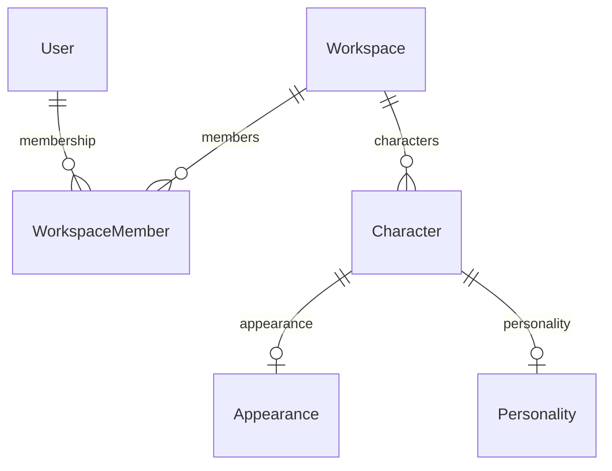

# Архитектура Oblik OS

## Текущее состояние: этап 5

Content реализован в `src/features/content`, AI — в `src/features/ai`.
UI → Server Action → Content service → generation service → Character Context
Builder → Prompt Engine → AIProvider → транзакционное сохранение Content.
Используется официальный OpenAI SDK/Responses API, server-only; конфигурация
ленивая, без обязательных AI env при build. Identity берётся из Character,
Personality — из relation; deterministic Memory retrieval этапа 4 ограничен 25
записями и 16000 символами. Appearance в текстовый контекст не входит.
Content хранит Workspace + Character, type/instruction/body/DRAFT, provider/model
и timestamps. Composite FK исключает конфликт tenant ID. ContentGeneration —
техническая квитанция идемпотентности, без текста или snapshots. Duplicate
Character не копирует ни Content, ни Memory. Полная схема, UX, проверки и
ограничения: [отчёт этапа 5](stage-5-report.md).

## Memory: этап 4

Memory реализована в `src/features/memory`: отдельная `MemoryEntry` принадлежит
Character. Workspace выводится через связь Character; повторный workspaceId
не хранится. Server-only service получает session/currentWorkspace, каждая
операция повторно проверяет membership и активный (не soft-deleted) Character
в транзакции. Изменения используют Serializable и повтор serialization conflicts.
Запросы к записи ограничены одновременно её id, characterId и tenant scope.
Фильтрация и сортировка выполняются БД, список ограничен 100 записями.
`getCharacterMemory(characterId, limit = 30)` возвращает структурированные
данные текущего Workspace, максимум 50 записей. Duplicate память не копирует.
Embeddings, векторный поиск и история не реализованы.
Детали: [отчёт этапа 4](stage-4-report.md).

## Character Core: этап 3

Character Core реализован в `src/features/characters`: server-only service
получает текущий Workspace через auth helpers, операции повторно проверяют
membership в транзакции и ограничивают запросы workspaceId/deletedAt.
Wizard создаёт Character/Appearance/Personality атомарно; доступны редакторы,
duplicate, archive/restore и soft delete. Schema Foundation не менялась.
Общие формы и Server Actions используют Zod; клиент не передаёт ownership.
Детали и результаты проверок: [отчёт этапа 3](stage-3-report.md).

## Authentication & User Workspace: этап 2

Добавлены Auth.js 4.24.15 stable (JWT strategy), Argon2id credentials,
серверный реестр AuthSession, email tokens и личный Workspace при регистрации.
Авторизация и persistence находятся в `src/features/auth`; данные читаются
только после проверки session и membership. Дизайн-система Foundation сохранена.
Полное описание и проверенные ограничения: [отчёт этапа 2](stage-2-report.md),
[README](../README.md), [подключение OAuth](auth-setup.md).

Ниже описание Foundation и будущих модулей, составленное на этапе 1.
Утверждения о неподключённых auth/UI/БД в исторических разделах относятся к этапу 1.

## Граница первого этапа (историческое состояние)

Oblik OS — система управления постоянными цифровыми персонажами.
Сейчас реализован технический фундамент: Next.js-приложение, App Shell,
маршруты, дизайн-токены, PostgreSQL-конфигурация и шесть основных моделей.

UI не читает БД, не создаёт пользователей, Workspace и персонажей.
Пустое состояние показывает отсутствие подключённой функциональности,
а не результат запроса к базе. Профиль по UUID — явно обозначенный каркас,
не свидетельство существования или доступности конкретного персонажа.
Неизвестные разделы и некорректные UUID возвращают 404.

## Стек и совместимость

- Node.js 24 LTS, Next.js 16.3.8, React 19.3.0.
- TypeScript 6.0.3 с `strict`; Tailwind CSS 4.3.3.
- PostgreSQL 18.6 в Docker Compose; Prisma 7.10.0.
- Prisma PostgreSQL driver adapter + `pg`; Zod 4 для validation.
- ESLint 9.39.5 и конфигурация Next.js 16.3.8.

Версии закреплены в package.json и package-lock.json. На момент разработки
Prisma `latest` указывал на 8.0.0-rc.19: выбрана последняя стабильная 7.10.0.
TypeScript 7 и ESLint 10 не выбраны из-за несовместимых peer dependencies
в цепочке eslint-config-next. Обновлять эти инструменты вместе с плагинами.
ESLint 9 уже помечен deprecated upstream; это известный долг инструментария.

Один модульный монолит: нет дополнительного backend, очередей или Redis.
Prisma Client генерируется в `src/generated/prisma` и не хранится в Git.
Prisma CLI читает URL из `prisma.config.ts`. Доступ к клиенту — только через
`src/db/client.ts`, с маркером `server-only`, валидацией URL и ограниченным pool.
Инициализация ленивая: build и UI работают без БД и AI-ключей.
Генератор использует `.ts` import extensions: проверочный CLI запускает клиент
через нативную поддержку TypeScript в Node 24 без дополнительного tsx loader.

## Поток данных на следующих этапах

```text
UI
  → Server Action / Route Handler
  → Session + проверка входа через Zod
  → Service: membership, роль, бизнес-правила
  → Repository: запрос с workspaceId и deletedAt
  → PostgreSQL
```

Компоненты отвечают за отображение. Сервисы — за правила и транзакции.
Repositories — за запросы. Пока запросов нет, эти слои не созданы пустыми.
Server Components используются по умолчанию; client-компоненты нужны
только для активной навигации и мобильного drawer.

## Модели и связи



| Модель          | Назначение и ограничения                                                                           |
| --------------- | -------------------------------------------------------------------------------------------------- |
| User            | UUID, name, nullable уникальные email/phone, avatarUrl, timestamps                                 |
| Workspace       | UUID, name, уникальный slug, timestamps                                                            |
| WorkspaceMember | UUID, FKs, OWNER/ADMIN/MEMBER; уникальная пара workspaceId/userId                                  |
| Character       | UUID, workspaceId, name/slug, gender/ageRange/niche, biography, статус, timestamps, deletedAt      |
| Appearance      | Уникальный characterId, структурированные характеристики и дополнительные JSONB attributes         |
| Personality     | Уникальный characterId, communicationStyle/tone/traits/description, instructions, JSONB attributes |

UUID и updatedAt формируются Prisma Client; прямой SQL должен задавать их
самостоятельно. Время хранится как timestamptz, часовой пояс отображения
определяется интерфейсом. Secondary JSONB предназначен для дополнительных
атрибутов, ключевые данные остаются структурированными.

В PostgreSQL nullable UNIQUE допускает несколько NULL. На этапе авторизации
email нужно нормализовать перед записью, телефон — привести к E.164.
Пустые строки для отсутствующих email/phone недопустимы на уровне validation.
Связь нескольких способов входа с одним аккаунтом требует подтверждения
владения, совпадение непроверенных контактов не является основанием для merge.

Foreign keys используют RESTRICT при физическом удалении. Character удаляется
мягко через deletedAt. ARCHIVED — отдельный статус, не удаление.
Slug уникален внутри Workspace и остаётся зарезервированным после soft delete:
это позволяет восстановить профиль без конфликта адресов.

Индексы покрывают membership по userId, пару Workspace/user, активный список
персонажей по workspaceId/deletedAt/updatedAt, фильтр по workspaceId/status.
Уникальные индексы уже покрывают characterId у Appearance и Personality.
Отдельные индексы всех дат и статусов без сценария запроса не добавлены.

## Workspace и доступ

Character принадлежит Workspace, а не User. Пользователь может состоять
в нескольких Workspace. Роли описаны в схеме, permissions появятся позже.

Будущая регистрация создаёт User, личный Workspace и OWNER membership
в одной транзакции. Инвариант «у пространства остаётся владелец» проверяется
сервисом в транзакции; enum сам по себе этот инвариант не обеспечивает.

Доступ к любому Character и его Appearance/Personality/Memory/Content проверяется
через membership из подтверждённой сессии. Workspace из URL или request body
не является разрешением. Запросы должны ограничиваться workspaceId и deletedAt.
Для чужого персонажа возвращается одинаковое с отсутствующим состояние.

На этапе 1 нет endpoint для чтения или изменения пользовательских данных.
Перед подключением реальной БД к интерфейсу нужна авторизация и tenant checks.

## Авторизация: этап 2

Реализованы email + password, Яндекс ID и современный VK ID.
Телефон/SMS не реализованы; nullable User.phone сохранён для расширения.

Credentials хранится отдельно в PasswordCredential. Внешние identities —
Account с уникальными provider/providerAccountId и userId/provider.
OAuth tokens не сохраняются. Auth.js работает без DB adapter: auth service
создаёт User, Account и Workspace/OWNER атомарно через Prisma transaction.

Штатный encrypted JWT содержит только sub (User UUID) и sid (AuthSession UUID).
Любая текущая сессия проверяется по AuthSession с абсолютным TTL 7 дней.
Logout отзывает sid; password reset и unlink отзывают все sid пользователя.
authVersion защищает от создания сессии из credentials, проверенных до reset.

Email verification/reset/add-password tokens: random 32 bytes, SHA-256 hash,
30 минут, одноразовое потребление в Serializable transaction с retry конфликтов.
Production EmailProvider пока отсутствует, development outbox — только локальный.
Неподтверждённые email не считаются подтверждёнными в production.

Account linking разрешён только с одноразовым AccountLinkIntent, текущей
серверной сессией и соответствующим provider. Password-аккаунт сначала
подтверждает email. Совпадение email не связывает пользователей.
Последний способ входа нельзя отключить, включая конкурентные транзакции.

Rate limiting — атомарный PostgreSQL upsert, HMAC identifiers, expiry buckets.
Auth.js обеспечивает CSRF/state/PKCE; кастомный VK exchange дополнительно
проверяет state и device_id. Origin и callback allowlist проверяются сервером.
Защищённые страницы, actions и DAL независимо требуют session/membership.
Next.js middleware/proxy для этой архитектуры не нужен.

## Будущие модели

| Модель             | Данные и связи                                                                                             |
| ------------------ | ---------------------------------------------------------------------------------------------------------- |
| Memory             | characterId, SHORT_TERM/LONG_TERM, content, важность, timestamps                                           |
| TimelineEvent      | characterId, eventAt отдельно от createdAt, description                                                    |
| Knowledge          | characterId и при необходимости workspaceId, source/content/processingStatus/metadata                      |
| MediaAsset         | characterId, storageKey, mimeType, size, purpose, metadata; файлы вне PostgreSQL                           |
| GenerationProvider | Код провайдера, capability, безопасная конфигурация без API secrets                                        |
| Generation         | characterId, providerId/model/status, promptVersion/contextSnapshot, result/error/tokenUsage/estimatedCost |
| ContentItem        | characterId, тип/статус, редактируемое содержание; связь с несколькими Generation                          |

Эти таблицы пока не создаются. У всех Character-owned сущностей доступ
проверяется через Workspace. Workspace-level Knowledge потребует собственного
scope и validation. RAG/embeddings проектируются после появления реальных данных.

## AI: исторический план этапа 1

Следующий эскиз сохранён как исторический план. Реализованный этап 5 описан
выше и в stage-5-report.md: только текст, без snapshots, Knowledge и MediaAsset.

```text
API / Server Action
  → проверка сессии и Workspace
  → Character Context Builder
  → Identity + Appearance + Personality + Memory + Knowledge + задача
  → Prompt Engine (версии шаблонов, лимиты контекста)
  → AIProvider
  → Generation: снимок контекста и исходный результат
  → ContentItem / MediaAsset: пользовательская рабочая версия
```

AIProvider — серверный интерфейс с capability (text/image/video/voice),
входными параметрами и нормализованным результатом. Реализации изолируют
API конкретных провайдеров. Не нужно требовать от одного провайдера все типы
генерации. Prompt Engine — отдельный модуль, без промптов в React.
Никаких AI SDK и ключей на этапе 1.

Generation сохраняет исходный результат и снимок контекста. ContentItem
редактируется независимо; повторная генерация создаёт новую запись Generation.
Оценка стоимости хранится отдельно от подтверждённого списания.
При добавлении AI нужны timeout, обработка ошибок и защита от повторной отправки.

## Storage: этап 6

StorageProvider: put/get/delete и выдача временных URL. Локальная реализация
для разработки, S3-compatible для production. Storage key не равен публичному URL.
Проверять membership, тип/размер файла и безопасные имена; закрытые файлы
отдавать после проверки доступа. Бинарные данные не хранятся в PostgreSQL.
Storage-код и S3 SDK на этапе 1 не добавлены.

## Маршруты

- `/` → `/dashboard`.
- `/dashboard`, `/characters`, `/characters/new`, `/settings`.
- `/characters/[id]` и разделы `identity`, `appearance`, `personality`,
  `memory`, `content`, `history`, `settings`.
- `/login`, `/register` — страницы с честным сообщением об этапе 2.

Разделы персонажа обслуживает один `[section]` route с allowlist.
Route group `(workspace)` объединяет App Shell, но не создаёт Workspace
и не является механизмом авторизации. `/api` отсутствует, пока нет API-сценариев.

## Дизайн-система и адаптивность

Токены в `src/app/globals.css`: цвета, Manrope, размеры текста, spacing,
radius, shadows, states. Tailwind подключён через PostCSS; CSS-компоненты
используют те же токены. Шрифт поставляется локально через Fontsource,
без запросов к Google Fonts при build или работе интерфейса.

Общие Button/ButtonLink, Badge, Card, Icon, PageHeader, EmptyState и FeaturePreview.
Формы, dropdown и обычные модальные окна будут добавлены с первым реальным
сценарием; пустых контролов нет.
Мобильное меню — native dialog: фокус ограничен drawer, Escape закрывает,
фокус возвращается на кнопку. Tabs профиля переносятся на следующую строку.
Есть skip link, semantic landmarks, focus-visible и prefers-reduced-motion.

## Известные ограничения и долг

- Docker Desktop и Linux Engine проверены. PostgreSQL запущен через Compose,
  первая миграция применена. Prisma Client читает все шесть моделей.
- Для Prisma CLI закреплены точечные dependency overrides: deepmerge-ts 8.0.2
  для @prisma/config и mysql2 3.24.5 для prisma. Это устраняет найденные audit
  findings без отката Prisma. Prisma config использует обычные объекты и deepmerge;
  изменённая семантика Maps в deepmerge-ts 8 здесь не используется. Конфигурация,
  валидация, генерация клиента и build проверяются после override. При обновлении
  Prisma убрать overrides, когда upstream включит исправленные зависимости.
  Prisma CLI может попадать в production audit через optional peer @prisma/client,
  хотя приложение не импортирует CLI. MySQL в продукте не используется.
- ESLint 9 нужен из-за peer constraints текущих плагинов Next.js;
  запланировано совместное обновление tooling.
- Это foundation, не готовый публичный SaaS: нет auth, tenant-aware repositories,
  CRUD, AI, storage, тестов пользовательских операций и VPS deployment.

Телефонная авторизация вынесена за рамки этапа 2 по утверждённому ТЗ.
Локальный `.env` уже создан со случайным паролем, отсутствующим в Git.

## Источники технических решений

- [Next.js: установка и требования](https://nextjs.org/docs/app/getting-started/installation).
- [Prisma 7: конфигурация и driver adapters](https://docs.prisma.io/docs/guides/upgrade-prisma-orm/v7).
- [Docker: PostgreSQL и persistence](https://docs.docker.com/guides/postgresql/immediate-setup-and-data-persistence/).
